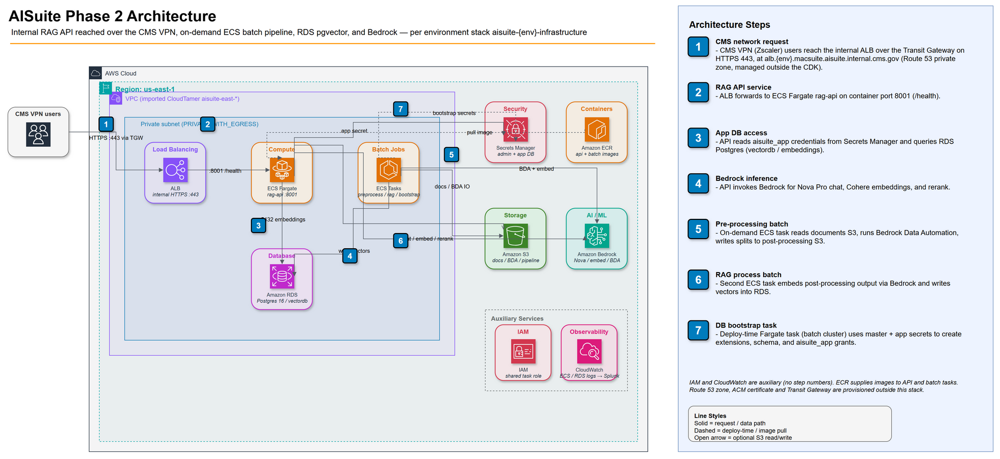
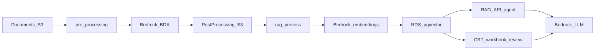

# AISuite RAG service

Application code for the CMCS Agentic RAG pipeline (Phase 2 packaging).

## Architecture

### Cloud layout

Each environment deploys an internal ALB and ECS Fargate RAG API, two
S3-triggered ingest Lambdas (pre-processing and embeddings), and private RDS
Postgres with pgvector. S3, Secrets Manager, ECR, and Bedrock sit outside the
VPC but in the same account/region.



*Alt text: AWS reference architecture for AISuite Phase 2 VPC, ECS, RDS, S3, and Bedrock.*

Open or edit the diagram in [diagrams.net](https://app.diagrams.net/) by loading
`docs/aisuite-phase2-architecture.drawio.png` (PNG with embedded draw.io XML).
See also the [repo root README](../../README.md#architecture).

### Pipeline data-flow



1. **Pre-processing** runs once for each PDF/DOCX uploaded to the documents
   bucket. It runs Bedrock Data Automation, parses the text/table/image
   outputs, splits text into chunks, and writes one combined JSON per file to
   `RAG_Output/` in the post-processing bucket.
2. **RAG process** runs once for each `RAG_Output/` JSON. It embeds every item
   with Bedrock and stores the vectors in that file’s `emb_<file>` table.
3. **API** answers a natural-language question by running it through the same
   two-stage review as a workbook requirement, against the contract table the
   request names.
4. **Contract review** runs the requirements in a CMS Contract Review Tool
   workbook through the two-stage review and writes the findings back into the
   workbook.

The foundation model is Amazon Nova 2 Lite (`us.amazon.nova-2-lite-v1:0`) and
embeddings are Cohere Embed v4 (`us.cohere.embed-v4:0`).

### Retrieval

`search/database_searching/search.py` offers four strategies over the active
contract’s embeddings table:

| Method | What it does |
|--------|--------------|
| `semantic_search` | Cosine nearest neighbours via the pgvector HNSW index |
| `fulltext_search` | Postgres full-text search over the generated `search_tsv` column |
| `hybrid_search` | Both of the above in one round trip, fused with reciprocal rank fusion |
| `reranked_search` | `hybrid_search` for recall, then Cohere rerank for precision — available but not wired into the agents |

Which strategy runs depends on what is being retrieved (`agents.py`):

| Retrieval | Strategy |
|-----------|----------|
| Seed passages for a requirement, and every `search_contract` call | `semantic_search` |
| Definitions (`search_definition`: the seed for a definition requirement, and every `lookup_definition` call) | `hybrid_search` on `"<term> definition"`, up to `MAX_DEFINITION_CHUNKS` (10) |
| Regulatory reference for Stage 2 (`retrieve_reference`) | `hybrid_search` on item ID + legal cite + requirement, up to `MAX_REFERENCE_CHUNKS` (5) |

Hybrid is used where exact wording matters. Vector search alone misses exact
vocabulary (statute cites such as `438.56(c)(2)(iii)`, item IDs, defined terms);
full-text alone misses paraphrased requirements. RRF needs no score
normalisation between the two, which matters because `ts_rank_cd` and cosine
distance are not on comparable scales.

Every row carries a **retrieval confidence**, which is the cosine similarity
(`1 - distance` from pgvector’s `<=>`) clamped to 0–1. `hybrid_search` scores the
lexical arm against the query vector too, so a chunk that only full-text found
still reports a confidence instead of a blank. The number is never shown to a
model — a model told a chunk scored 0.47 hands that back as its own confidence,
which would leave the two confidence columns in the workbook saying the same
thing twice.

### Two-stage review

`review_requirement()` in `search/database_searching/agents.py` reviews one
requirement:

1. **Seed retrieval.** For a "definition for the term “X”" requirement, the
   term's definition first (`retrieve_definition`), then a semantic search on the
   requirement text. Every chunk retrieved is recorded on `ContractDeps.chunks`.
2. **Stage 1, Evidence Analyst.** Reads the seed passages, may call
   `search_contract` and `lookup_definition`, and returns `Reasoning`, `Evidence`
   (`chunk_id` + exact `quote`) and `MissingInformation`. Output that does not
   parse as JSON gets one retry with every retrieved chunk in the prompt.
3. **Python verification.** `build_verified_evidence()` checks every quote against
   the retrieved text (`locate_quote`, 95% match). A real quote cited to the wrong
   chunk is moved to the right one; an invented chunk ID is dropped.
   `calculate_retrieval_confidence()` scores the verified evidence.
4. **Regulatory reference.** `retrieve_reference()` pulls up to 6,000 characters of
   42 CFR Part 438 / CMS State Guide text from the shared regulations table (see
   [Shared regulations table](#shared-regulations-table)). It is never recorded as
   contract evidence, so it can't be quoted as the contract.
5. **Stage 2, Decision Analyst.** Gets the requirement, Stage 1's reasoning, only the
   *verified* evidence, the missing information, the regulatory reference and the
   retrieval confidence band. It returns `Recommendation` (`MET` / `UNSURE`),
   `Response` and `DecisionConfidence` (`HIGH` / `MEDIUM` / `LOW`). It runs with Nova
   extended thinking (`reasoningConfig`, effort `medium`, `max_tokens` 8000).
6. **Guardrails** in Python, after Stage 2:
   - `MET` with `LOW` decision confidence becomes `UNSURE`.
   - `MET` with retrieval confidence under `MEDIUM_CONFIDENCE_THRESHOLD` (0.40)
     becomes `UNSURE` with `LOW`, and the response says why.

Any exception leaves the requirement `UNSURE` / `Low` with the error on
`RequirementReview.error`, so one bad row never stops a run.

### Agent harness

Every model loop in a requirement review runs on the Strands SDK through
`search/database_searching/strands_harness.py`: Stage 1 (`run_evidence`) and Stage 2
(`run_decision`). `build_agent` uses `create_harness` with every default off: no shell, file or web
tools, no memory, no sessions. Stage 1 gets exactly two tools, `search_contract` and
`lookup_definition`; Stage 2 gets none. Strands runs in this process, so both tools reach pgvector
through backends injected from `agents.py` (`run_contract_search`, `run_definition_lookup`) and the
shared asyncpg pool. `model_provider.strands_model()` builds one `BedrockModel` per settings
dict (Stage 1: temperature 0; Stage 2: adds reasoning) and caches it. Each run gets a new `Agent` because an agent
keeps history and refuses concurrent calls; models are shared. Agents must be called with
`invoke_async`, because `agent(...)` runs on another event loop, where the asyncpg pool does not
work.

Stage 1 forces the `EvidenceAnalysis` schema, which costs one extra model turn per requirement.
A run that fails the schema twice falls back to the usual parse-and-retry path. `evidence_goal`
(a Strands `GoalLoop`) then checks the analysis in Python and sends it back once if a quote is not
in its chunk, a chunk was never retrieved, or a definition requirement is left unaddressed. Stage 2 returns
plain JSON text, because it runs with Nova reasoning on.

### Retrieval policy

`search_contract` and `lookup_definition` only retrieve. What Stage 1 is *allowed* to retrieve is
decided around them:

| Where | Policy |
|------|--------|
| `run_evidence_stage` raises `SearchRefused` | `MAX_SEARCHES` (3) per requirement, then the tool call fails. A model that keeps searching instead of committing to a status is told to decide on what it has. Charged before the search runs, so a backend failure costs a search rather than letting the same error be retried forever. |
| `run_definition_lookup` raises `SearchRefused` | `MAX_DEFINITION_LOOKUPS` (2) per requirement, a budget separate from searches: the term and one equivalent. Same exact-match query as the definition seed retrieval (`search_definition`), so short glossary entries that semantic search ranks low are still found. A blank term is refused without spending the budget. Returned chunks are recorded, so quotes from them verify like any other. |
| `call_backend` catches the exception | A database or boto error becomes "try a shorter query" (search) or "use search_contract instead" (lookup). The raw exception is logged, not handed to the model, which can do nothing with it. |

A failed tool result rather than a success message that says the budget is gone: the call did
not happen, so recording it as successful misleads both the model and the trace. The model still
sees the reason and adapts. Stage 1's turn limit is `6 + MAX_SEARCHES + MAX_DEFINITION_LOOKUPS`;
Stage 2 gets 5.

### Model resilience

`ModelErrorRetry` in `strands_harness.py` is the retry strategy on every agent. It re-sends a
request that came back as Bedrock's 424 `ModelErrorException`, up to `MODEL_ATTEMPTS` (3) with a
backoff (`RETRY_DELAY_SECONDS`, 4). Nova answers a tool-use turn with a malformed block often
enough to matter: on Nova Pro, three requirements out of 667 died on *"Model produced invalid
sequence as part of ToolUse"* in a full CRT run, each one a row a reviewer then has to do by
hand. botocore does not retry a 4xx, reasonably, but this particular one is not the caller's
fault, and the request that failed was fine, so the retry sends it again unchanged.

Throttling is also retried (Strands' default), with up to `THROTTLE_ATTEMPTS` (6) attempts in
total. The 424 count is kept separately, so earlier throttles cannot use up the 424 attempts.
Nothing else is retried. A 400, an access denial, or an expired token would
fail identically three times over, and the run is better off surfacing it at once. Whatever still
fails lands in `RequirementReview.error` and the Error column.

### What gets embedded

`data_preprocessing/parsing/parsed_text_data.py` drops text that would compete
with real provisions at retrieval time:

| Filter | Why |
|--------|-----|
| `SKIP_SUBTYPES` — `PAGE_NUMBER`, `FOOTER`, `HEADER` | A running footer embeds like any other chunk. This contract had 201 identical `RFP Boilerplate I 07012019` footers and 199 page numbers. |
| `MIN_CONTENT_CHARS` | Empty list scaffolding (`- \n- \n-`), a stray `[X]`, a bare `## J.` — nothing anyone could retrieve. |

Section headers are kept: they are how a requirement about a named section gets
found. Printed table-of-contents pages are **not** filtered out, so a query can
come back with a contents row — a section title against a page label — instead of
the provision it was asking about. The analyst prompt tells the model not to cite
one.

A chunk's position in the file comes from `page_indices` where BDA gives one and
from `locations[].page_index` where it does not, because a couple of hundred
elements only carry the latter and would otherwise land with no page — and a
chunk with no page cannot be cited.

### Page numbers

On a document with front matter, position in the file is not the number printed
on the page: this contract opens with 21 roman-numeral pages and then restarts at
1, so every citation in the body was 21 pages out from what the reviewer sees.
`printed_page_map()` in `parsed_text_data.py` reads the printed number instead —
BDA files it as a `PAGE_NUMBER` element, and on the odd page in the footer or
header, so those are read too but only after every `PAGE_NUMBER` has had its say.
Away from a `PAGE_NUMBER` element the text has to say what it is (`Page 12`), or
the `I` in the `RFP Boilerplate I 07012019` footer would read as page one.

`settle_page_numbers()` then fills the pages BDA read no number on and corrects
the ones it misread. Printed numbers run one to a page, so the step between a
page's position in the file and the number printed on it holds steady for as long
as the numbering does; where the numbered pages either side of a page agree on
that step, the page between them has to follow it. Where they disagree the page
is left as BDA read it, so the restart from `xxi` to `1` survives. On this
contract that lands all 204 pages: `i` to `xxi`, then `1` to `183`.

The number rides through pre-processing and embedding as the `printed_page`
metadata key, so it only reaches citations for documents ingested after this
change — older rows carry no `printed_page` and fall back to file position.

### Citations

Chunk metadata carries `doc_id`, the zero-based page index, and `printed_page`,
and that is all a citation is built from. `page_label()` in
`search/database_searching/review_models.py` renders the printed number as
`page 85`, falling back to the index stepped forward by one where there is none.
That is what the model sees in each chunk header and what lands in Where Found
and in the quotes on the RAG Analysis sheet. `page_numbers()` on
`RequirementReview` returns the same numbers bare, ordered by position in the
file, for the **Page number** column and the `Page number:` line in General
Comments — the column exists so a reviewer can turn to the pages, and citation
order is no help for that. File order rather than alphabetical, because
roman-numeral front matter and the body's own numbering do not sort together as
text. Where Found keeps citation order, because it pairs line for line with the
quotes underneath it. Each quote is headed with the document name as well as the
page, so a reviewer knows which file to open before turning to the page.

Stage 1 cites by chunk ID. `format_retrieved_chunks()` in
`search/database_searching/agents.py` heads each passage with `[chunk N]`, the
document and the page, and `EvidenceAnalysis.Evidence` pairs each quote with the
`chunk_id` it came from. `locate_quote()` then matches the quote back to the
retrieved text. That match is what `verified` means: the wording really is in the
contract rather than something the model composed. Only verified evidence reaches
Stage 2, Where Found and the quotes in the workbook. Chunk IDs mean nothing to a
reviewer, so `in_reviewer_terms()` swaps any "chunk 3566" in the model's prose for
the page it came from as the workbook is written.

## Running the service

Work from this directory (`services/rag`) so Python packages resolve. Install
deps from `requirements.txt` first. There is no Docker Compose local stack;
local runs still need AWS access (S3, Bedrock) and a reachable Postgres
(pgvector), or Secrets Manager credentials for the private RDS (often via
VPN/bastion).

### Entry points

| Mode | Local command | Cloud |
|------|---------------|--------|
| Query API | `python -m search.routes.endpoint` (or Docker image `CMD` → uvicorn) | Always-on ECS Fargate service on port `8001` |
| Pre-process (one file) | `python -m data_preprocessing.pre_processing <source-key>` | Lambda, one invocation per uploaded `.pdf` / `.docx` |
| Embeddings (one file) | `python -m data_embeddings_storage.rag_process RAG_Output/<folders>/<file>.json` | Lambda, one invocation per `RAG_Output/` JSON |
| Contract review | `python search/excel_process/process_excel_with_rag.py` | not deployed yet; run it on demand |
| DB bootstrap | usually not local (needs master secret) | One-shot Fargate task: `python -m data_embeddings_storage.database.bootstrap` |

Typical ingest order for one document (the deployed Lambdas do this on upload):

```sh
python -m data_preprocessing.pre_processing NE/contract.pdf
python -m data_embeddings_storage.rag_process RAG_Output/NE/contract.json
```

Writing `RAG_Output/` into a deployed post-processing bucket already triggers the
embeddings Lambda, so run the second command only where that Lambda is not
deployed.

### Query API (local)

```sh
export API_HOST=0.0.0.0
export API_PORT=8001
# Optional: API_RELOAD=true
python -m search.routes.endpoint
```

| Endpoint | Purpose |
|----------|---------|
| `GET /health` | Health check |
| `GET /contracts` | `embeddings*` tables that exist in `aisuite_schema`, and the default |
| `GET /agent?query=…&contract=…` | Agent answer (query string) |
| `POST /agent` | Agent answer; body `{"query": "…", "contract": "…"}` |
| `GET /docs` | OpenAPI UI |

`contract` is an embeddings table name, for example `embeddings_ok_1`. It is
optional but recommended: without it the request uses the active contract's
table from the INI (or `EMBEDDINGS_TABLE_NAME`), which can change on the next
redeploy. A name that is not one of the tables `GET /contracts` lists is a 400.
The response includes `contract`, the table that actually answered.

Example:

```sh
curl -s "http://127.0.0.1:8001/contracts"
curl -s "http://127.0.0.1:8001/agent?query=What+is+coverage+for+NEMT%3F&contract=embeddings_ok_1"
curl -s -X POST "http://127.0.0.1:8001/agent" \
  -H "Content-Type: application/json" \
  -d '{"query":"What is coverage for NEMT?","contract":"embeddings_ok_1"}'
```

### Contract review run job

Drop the CMS Contract Review Tool workbook (`.xlsm` or `.xlsx`) into
`output_excel/` at the repository root and run:

```sh
python search/excel_process/process_excel_with_rag.py
```

Every requirement row goes through the [two-stage review](#two-stage-review): an
evidence analyst that finds and quotes the contract text, and a decision analyst
that makes the final call on the verified evidence, read against 42 CFR Part 438
and the CMS State Guide. Findings are written back into the columns a reviewer
already works from, and everything that does not fit a form field goes onto an
added **RAG Analysis** sheet keyed by sheet and row.

| Column | What is written |
|--------|-----------------|
| Status | `MET with <band> Confidence` or `Unsure with <band> Confidence`. The band is Stage 2's decision confidence (High / Medium / Low), falling back to the retrieval band for older sidecar rows. The MET guardrails are applied again here. |
| Where Found | Locations of the verified evidence |
| General Comments | `AI Reasoning:` (Stage 1), `Decision rationale:` (Stage 2), then `Cited contract text:` with the verified quotes |

Follow-up Required is not written for now (the code is commented out in
`write_review`); follow-up and missing information are on the RAG Analysis
sheet, along with the page numbers, the decision, retrieval and combined
confidence, whether quotes verified, chunks retrieved, every quote, the model
and any error.

The cell is capped at `MAX_CELL_CHARS` (4000), and quotes are dropped **whole** to
stay under it, with a line saying how many went missing and where to find them.
Cutting the text at an arbitrary character left the last citation ending
mid-sentence, still wrapped in quote marks — indistinguishable from the contract
saying exactly that.

| Flag | Effect |
|------|--------|
| `--folder` | Where to look for workbooks (default `output_excel/`) |
| `--sheet` | Only this sheet; repeatable |
| `--limit` | Stop after N requirements, for a smoke test |
| `--concurrency` | Requirements in flight at once (default 4) |
| `--skip-answered` | Leave rows that already have a Status alone. By default every visible requirement row is reviewed and overwritten, including Met / Yes / N/A and gray rows |
| `--include-hidden` | Also review hidden rows (for example collapsed CHIP sections); skipped by default |
| `--fresh` | Discard the sidecar and review everything again |
| `--render-only` | Rebuild the workbook from the sidecar without reviewing |

A full CRT is 667 requirements, each a multi-turn Stage 1 loop plus a Stage 2
call with extended thinking, so each finding is
appended to a `<name>.xlsm.reviewed.jsonl` sidecar as it completes. Re-running
resumes from that sidecar rather than paying for the same rows twice. The
reviewed workbook is saved as `<name>.reviewed.xlsm`; the uploaded file is never
modified.

`--render-only` rebuilds the workbook from that sidecar and reviews nothing, which
turns a change to how a finding is presented into a four-second check instead of
an hour of Bedrock time. It needs no Bedrock and no database: the agents and the
connection pool are imported inside the functions that use them, because
`common/utils/db_settings.py` fetches the database secret at import and importing it
at the top of the module killed a render before `main()` saw the flag. Rows the
sidecar does not cover are named rather than left silently blank, since a workbook
rendering 600 of 667 requirements looks finished. It refuses to run with `--fresh`,
which would delete the sidecar it renders from.

One thing to know about the output: openpyxl warns that it is dropping the
workbook's conditional-formatting extension. Macros, dropdowns and layout survive
the round trip; the colour-scale rules on the Summary sheet do not. If the
reviewed workbook is open in Excel, it is saved as `<name>.reviewed-2.xlsm`
instead.

### Cloud operation

- **API**: deployed via the AISuite stack (desired count gated by
  `aisuite:activateApi`). Traffic is internal ALB only.
- **Batch / bootstrap**: run the corresponding ECS task definitions on the
  private cluster/subnets. Stack outputs include bootstrap cluster name, task
  definition ARN, security group, and subnet IDs (`RunTask` contract).
- Bucket names and model IDs are injected via Lambda / ECS environment variables
  (see below), which override matching keys in `aws.properties.ini`.

## Environment variables

Path, model, and table defaults live in
[`common/utils/aws.properties.ini`](common/utils/aws.properties.ini). Comments
at the top of that file list env → property mappings. `Helper.get_property`
resolves an environment override first (`Helper.ENV_PROPERTY_OVERRIDES`), then
the one `[contract:…]` section with `active = true`, then `[default]`. Zero or
two active contracts is an error. See [Contracts](#contracts).

### Cloud (injected by CDK)

| Variable | Role |
|----------|------|
| `AWS_REGION` / `AWS_DEFAULT_REGION` | AWS region (search API) |
| `DOCUMENTS_BUCKET` | Source documents bucket (pre-processing Lambda) |
| `POST_PROCESSING_BUCKET` | BDA / RAG post-processing bucket (both Lambdas) |
| `PIPELINE_TEMP_BUCKET` | Temp / summary logs bucket (pre-processing Lambda) |
| `DB_SECRET_ARN` (or `DB_SECRET_NAME`) | Secrets Manager secret for app DB credentials (embeddings Lambda and search API) |
| `BEDROCK_MODEL_ID` | Foundation LLM |
| `BEDROCK_EMBED_MODEL_ID` | Embedding model |
| `EMBEDDINGS_TABLE_NAME` | Default table for the search API when a request names no `contract`; overrides the active contract's `embeddings_table_name` |

**Bootstrap task only** (from Secrets Manager at task start; never put in task
env plain text, workflow args, or logs):

| Variable | Role |
|----------|------|
| `PGHOST`, `PGPORT`, `PGUSER`, `PGDATABASE`, `PGPASSWORD` | Master DB connection |
| `APP_PASSWORD` | Password for `aisuite_app` |

### Local development

There is no `.env` file and no dotenv loading. AWS credentials and the default
region come from the standard AWS CLI configuration (`aws configure`, or
`AWS_PROFILE` for a named profile) via the boto3 default credential chain;
database credentials always come from Secrets Manager.

| Variable | Role |
|----------|------|
| `AIPropFile` | Path to an alternate properties INI (absolute or relative) |
| `DB_SECRET_ARN` / `DB_SECRET_NAME` | Secrets Manager secret for app DB credentials (INI `vector-db-admin-secret` otherwise) |
| `API_HOST`, `API_PORT`, `API_RELOAD` | API bind (defaults `0.0.0.0`, `8001`, `false`) |
| Same bucket/model vars as cloud | Optional overrides over the shipped INI |

Tuning values are read from the INI only: `embedding_dimension`,
`embedding_batch_size`, `db_pool_min`, `db_pool_max`.

Constraints: private RDS is not open to the public internet; Bedrock and S3
need valid account permissions for the non-prod (or prod) account you target.

## Specifying documents and contracts

Ingest runs once per file (see below). There is no document-id filter on
search.

### Ingest (event-driven)

Drop a file, or a folder of files, into `input_bucket_name`. S3 sends one event
notification per `.pdf`, `.PDF`, `.docx` or `.DOCX` object directly to the
pre-processing Lambda (`data_preprocessing.pre_processing.handler`), so every
file gets its own invocation. Suffix filters are case-sensitive, so other
casings such as `.Pdf` are ignored. All paths come from the uploaded object's
key; nothing in the INI selects a prefix.

Output for `<folder>/<file>.pdf` in the post-processing bucket:

- `<folder>_bdaoutput/<file>/` raw BDA output
- `<folder>_bdaoutput/BDA{Text,Table,Image}Output/`-style per-kind JSONs named
  `<file>-preprocessed-{text,table,image}.json`
- `RAG_Output/<folder>/<file>.json`, the text, table and image items combined
  into one list. Text is split into 1,024-character chunks with a 30-character
  overlap (`data_preprocessing/recursive_text_splitter.py`).

Each new `RAG_Output/**.json` triggers the embeddings Lambda
(`data_embeddings_storage.rag_process.handler`), which writes to its own table
`emb_<filename>` (lowercased, non-alphanumerics become `_`, max 41 chars with a
hash suffix when truncated). The table name is not read from the INI.

Both Lambdas are standard Lambda functions in the VPC's private subnets with a
15-minute timeout (the Lambda maximum). Each runs at most 5 files at once and
scales to zero when idle. Uploads beyond that wait in Lambda's asynchronous
event queue for up to 6 hours, and a failed invocation is retried twice.

### Contracts

Each `[contract:<name>]` section in `aws.properties.ini` overlays `[default]`
with that contract's S3 prefixes (`input_prefix`, `output_prefix`, the
`BDA*OutputFolder`s, `RagSplitOutPutFolder`) and its `embeddings_table_name`.
Exactly one section has `active = true`; today that is `contract:ok_1`
(`embeddings_ok_1`).

### Shared regulations table

`[contract:common_cms_regs]` (`embeddings_cms_regs`) holds 42 CFR Part 438 and the
CMS State Guide. Stage 2 always reads it, whichever contract is active
(`Helper.get_common_embeddings_table_name()` reads that section directly). It is
interpretive context only and never contract evidence. Leave it `active = false`
and set it `true` only while re-ingesting it. If the section is missing, Stage 2
runs without a regulatory reference and logs that.

### Search (API)

The agent takes a natural-language `query` and an optional `contract`. The
`contract` is validated against the `embeddings*` tables that exist in
`aisuite_schema`, not against the INI, and an omitted `contract` falls back to
`EMBEDDINGS_TABLE_NAME` or the active contract's table. The per-file `emb_*`
tables written by the embeddings Lambda don't match `embeddings*`, so the API
can't select them yet.

## Shared buckets (dev)

| Role | Dev bucket |
|------|------------|
| Source documents (input) | `aisuite-dev-contract-rag` |
| BDA / RAG post-processing | `aisuite-dev-contract-rag-post-processing` |
| Pipeline temp / summary logs | `aisuite-dev-llm-pipeline-temp` |

Deployed bucket names come from env (`DOCUMENTS_BUCKET`, `POST_PROCESSING_BUCKET`,
`PIPELINE_TEMP_BUCKET`).
## One-time DB bootstrap (app user)

CDK manages an on-demand Fargate task that bootstraps the private RDS database.
It reuses the batch ECS cluster, ECR repository, immutable batch image tag,
private subnets, and application security group. It is a one-shot task
definition, not an ECS service.

Run the task after the initial infrastructure deploy and after pushing the
corresponding batch image. The stack outputs `BootstrapClusterName`,
`BootstrapTaskDefinitionArn`, `BootstrapSecurityGroupId`, and
`BootstrapSubnetIds` as the `RunTask` contract. Deployment workflow automation
is handled separately.

ECS injects `PGHOST`, `PGPORT`, `PGUSER`, `PGDATABASE`, and `PGPASSWORD` from
the master database secret and `APP_PASSWORD` from the app database secret.
The values are resolved by the ECS execution role at task startup; they must
not be supplied through task-definition environment values, workflow
arguments, or logs.

The bootstrap entrypoint is
`data_embeddings_storage.database.bootstrap`. It runs idempotently and:

- creates the `vector` and `pg_trgm` extensions;
- creates the dedicated `aisuite_schema` (not `public`) for application objects;
- migrates any legacy `public.embeddings*` tables into `aisuite_schema`;
- creates each contract’s embeddings table (from `aws.properties.ini`) and HNSW,
  metadata GIN, trigram GIN, and full-text GIN indexes matching `table_setup.py`;
- creates `aisuite_app` or safely updates its password from the app secret;
- creates the shared `aisuite_app_owner` NOLOGIN group role, grants it to
  both rotation logins, and reassigns `aisuite_schema` (tables and sequences)
  to that owner so index DDL succeeds under either Secrets Manager login;
- grants `CONNECT` on the database and schema/table privileges on
  `aisuite_schema` to `aisuite_app` and `aisuite_app_clone` (Secrets Manager
  multi-user rotation), including `CREATE` on the app schema for idempotent
  table setup;
- sets each app role’s `search_path` to `aisuite_schema, public`; and
- grants default table DML and sequence usage/select privileges in
  `aisuite_schema` for objects created by the bootstrap master role.

Runtime connections set `search_path` on pool init so unqualified table names
resolve to `aisuite_schema` regardless of which rotation login is active.
A fresh environment needs bootstrap (or the master SQL remediation below)
before the app path can create indexes.

### Operator remediation (VPN + CLI)

```sh
export AWS_PROFILE=aisuite-dev
./scripts/psql-rag.sh --master -v ON_ERROR_STOP=1 -f scripts/sql/init-aisuite-schema.sql
./scripts/psql-rag.sh --probe
```

`init-aisuite-schema.sql` creates the schema, migrates leftover
`public.embeddings*`, installs `aisuite_app_owner`, reassigns object
ownership, and grants both app roles (not full table DDL).

After bootstrap, applications use
`aisuite/{env}/rag-app-db-credentials`, not the master
`rag-db-credentials` secret. Schema DDL remains a privileged bootstrap
responsibility.
